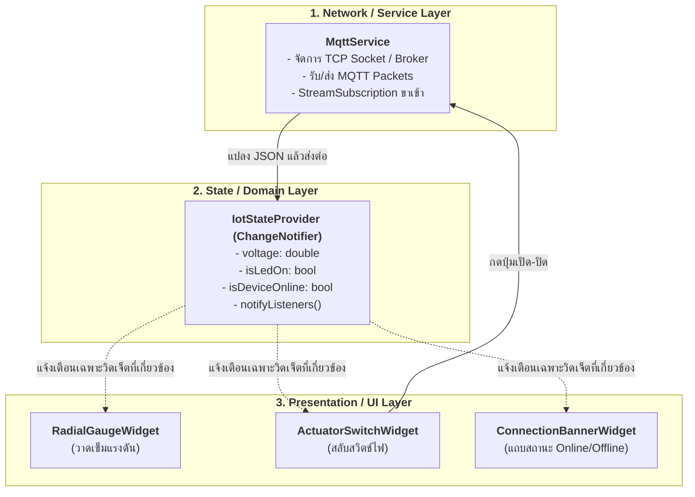

# 12.3 การจัดการสถานะเชิงปฏิกิริยาสำหรับ IoT (State Management & Reactive IoT UI)

---

## 12.3.1 ความสำคัญของการจัดการสถานะในระบบ IoT (The State Dilemma)

ในแอปพลิเคชัน IoT ข้อมูลสถานะไม่ได้เกิดขึ้นจากการกดปุ่มของผู้ใช้เพียงอย่างเดียว แต่เกิดขึ้นจาก **เหตุการณ์เครือข่ายภายนอกที่ควบคุมเวลาไม่ได้ (Unsolicited External Events)** เช่น:
* บอร์ด ESP32 ยิงค่าแรงดันแอนะล็อกขึ้นมาทุกๆ 500 มิลลิวินาที
* บอร์ดส่งข้อความพินัยกรรม (LWT) แจ้งว่าอุปกรณ์ดับไปกะทันหัน
* ผู้ใช้งานคนอื่นเปิดสวิตช์ไฟผ่านคอนโซล ทำให้สถานะของสวิตช์ในมือถือของเราต้องเปลี่ยนตามทันที

หากนักพัฒนาเขียนโค้ดโดยรวมตรรกะเครือข่าย (MQTT Socket) และการอัปเดตหน้าจอ (`setState()`) ไว้ในวิดเจ็ตเดียวกัน โค้ดจะกลายเป็น **Spaghetti Code** ที่ยากต่อการทดสอบ บำรุงรักษา และก่อให้เกิดปัญหาหน้าจอกระตุก (UI Jitter) อย่างหลีกเลี่ยงไม่ได้

```
+-----------------------------------------------------------------------------------+
|               ปัญหาของการรวม Network Layer และ UI Layer ไว้ในก้อนเดียวกัน         |
+-----------------------------------------------------------------------------------+

   [ MQTT Message ขาเข้า ] ──► setState() ──► Rebuild ทั้งหน้าจอ (Scaffold, AppBar, ฯลฯ)
                                                    │
                                                    ▼
                                    *สูญเสียพลังงาน และ Frame Rate ตก*
```

---

## 12.3.2 สถาปัตยกรรมแบบแยกส่วน (Separation of Concerns: Layered Architecture)

เพื่อแก้ปัญหานี้ เราจะแบ่งสถาปัตยกรรมของแอปพลิเคชันออกเป็น 3 เลเยอร์ที่แยกหน้าที่กันอย่างชัดเจน:



1. **Service Layer (`MqttService`)**: รับผิดชอบเรื่องการเชื่อมต่อ TCP, การส่ง PINGREQ, การแปลงข้อความไบต์เป็น UTF-8 String เท่านั้น โดยไม่สนใจว่าหน้าจอจะแสดงผลอย่างไร
2. **State Layer (`IotStateProvider`)**: จัดเก็บตัวแปรสถานะของระบบ เช่น ค่าแรงดันล่าสุด, สถานะ LED, ค่าประวัติย้อนหลัง และเป็นจุดรวมศูนย์ในการเรียก `notifyListeners()` เมื่อข้อมูลเปลี่ยน
3. **UI Layer (Widgets)**: ดักฟังเฉพาะค่าสถานะที่ตนเองสนใจผ่าน `ListenableBuilder` หรือ `Consumer` เพื่อทำการ Rebuild เฉพาะจุดเล็กๆ เท่านั้น

---

## 12.3.3 การสร้าง State Provider ด้วย `ChangeNotifier`

`ChangeNotifier` เป็นคลาสพื้นฐานใน Flutter SDK ที่ทำงานตามรูปแบบ **Observer Pattern** มีความเบา ไม่ต้องการไลบรารีภายนอกซับซ้อน และมีประสิทธิภาพสูง:

```dart
import 'dart:convert';
import 'package:flutter/foundation.dart';

class IotStateProvider extends ChangeNotifier {
  // 1. ตัวแปรเก็บสถานะ (State Variables)
  double _voltage = 0.0;
  int _rawAdc = 0;
  bool _isLedOn = false;
  bool _isDeviceOnline = false;
  final List<double> _voltageHistory = [];

  // 2. Getters สำหรับให้ UI ดึงค่าไปใช้
  double get voltage => _voltage;
  int get rawAdc => _rawAdc;
  bool get isLedOn => _isLedOn;
  bool get isDeviceOnline => _isDeviceOnline;
  List<double> get voltageHistory => List.unmodifiable(_voltageHistory);

  // 3. ฟังก์ชันอัปเดตข้อมูลเซนเซอร์ Telemetry
  void updateTelemetry(String jsonString) {
    try {
      final map = jsonDecode(jsonString) as Map<String, dynamic>;
      _voltage = (map['voltage'] as num?)?.toDouble() ?? _voltage;
      _rawAdc = (map['raw'] as num?)?.toInt() ?? _rawAdc;

      // บันทึกประวัติ 20 ค่าล่าสุดสำหรับวาดกราฟ
      _voltageHistory.add(_voltage);
      if (_voltageHistory.length > 20) {
        _voltageHistory.removeAt(0);
      }

      // กระตุ้นให้ UI ที่ดักฟังทำการวาดใหม่
      notifyListeners();
    } catch (e) {
      debugPrint('Error parsing telemetry: $e');
    }
  }

  // 4. ฟังก์ชันอัปเดตสถานะ Actuator
  void updateActuatorState(bool status) {
    if (_isLedOn != status) {
      _isLedOn = status;
      notifyListeners();
    }
  }

  // 5. ฟังก์ชันอัปเดตสถานะการออนไลน์ของอุปกรณ์ (จาก LWT / Ping)
  void setDeviceOnlineStatus(bool online) {
    if (_isDeviceOnline != online) {
      _isDeviceOnline = online;
      notifyListeners();
    }
  }
}
```

---

## 12.3.4 การผูก State เข้ากับ Widget ด้วย `ListenableBuilder`

ตั้งแต่ Flutter 3.10 เป็นต้นมา Flutter ได้เปิดตัววิดเจ็ต **`ListenableBuilder`** ซึ่งช่วยให้เราสามารถ Rebuild เฉพาะวิดเจ็ตที่ต้องการ โดยไม่ต้อง Rebuild ทั้งหน้าจอ:

```dart
// ตัวอย่าง: วิดเจ็ตเข็มเกจวัดจะ Rebuild เฉพาะเมื่อค่าแรงดันเปลี่ยนเท่านั้น
Widget buildGaugeSection(IotStateProvider provider) {
  return ListenableBuilder(
    listenable: provider,
    builder: (context, child) {
      return Column(
        children: [
          Text(
            'แรงดันไฟฟ้า: ${provider.voltage.toStringAsFixed(2)} V',
            style: const TextStyle(fontSize: 24, fontWeight: FontWeight.bold),
          ),
          Text('ค่าดิบ ADC: ${provider.rawAdc}'),
          // child ตัวนี้จะไม่ถูก rebuild ซ้ำ ซ้อน ประหยัดพลังงาน
        ],
      );
    },
  );
}
```

---

## 12.3.5 การจัดการข้อมูลความถี่สูง (Handling High-Frequency Telemetry)

ในงานวิศวกรรม IoT หากเซนเซอร์อ่านค่าและส่ง MQTT มาด้วยความถี่สูงเกินไป (เช่น 20–50 Hz) การสั่ง `notifyListeners()` ทุกครั้งจะทำให้ Flutter Engine เกิดภาระงานหนักจนสูญเสียเฟรมเรต 60 FPS กลยุทธ์ในการควบคุมความถี่ทำได้ดังนี้:

### กลยุทธ์การจำกัดความถี่ (Throttling Technique)
```dart
DateTime _lastUiUpdateTime = DateTime.now();
const int minUpdateIntervalMs = 100; // อัปเดตหน้าจอสูงสุดไม่เกิน 10 ครั้งต่อวินาที (100 ms)

void updateTelemetryThrottled(String jsonString) {
  final now = DateTime.now();
  if (now.difference(_lastUiUpdateTime).inMilliseconds >= minUpdateIntervalMs) {
    _lastUiUpdateTime = now;
    updateTelemetry(jsonString); // รันการ parse และ notifyListeners()
  }
}
```

---

## 12.3.6 กลไกการอัปเดตสวิตช์: Optimistic UI vs Acknowledged State

เมื่อผู้ใช้แตะปุ่มสวิตช์บนมือถือ มี 2 แนวทางในการสะท้อนผลกลับมายัง UI:

```
  1. Optimistic UI (สวิตช์เด้งเปิดทันที -> หากส่งไม่ผ่านค่อยเด้งกลับ):
     [ แตะสวิตช์ ] ──► เปลี่ยน UI ทันที ──► ส่ง MQTT Command
     *ข้อดี: ผู้ใช้รู้สึกว่าแอปตอบสนองไวมาก*
     *ข้อเสีย: หากบอร์ดหลุดการเชื่อมต่อ สถานะบนจอจะโกหกผู้ใช้*

  2. Acknowledged State (รอให้อุปกรณ์ตอบรับสถานะกลับมาก่อน จึงเปลี่ยน UI):
     [ แตะสวิตช์ ] ──► แสดงสถานะ Loading ──► ส่ง MQTT Command ──► บอร์ดส่ง ACK ──► เปลี่ยน UI
     *ข้อดี: แม่นยำ 100% สอดคล้องกับสถานะจริงทางกายภาพของฮาร์ดแวร์*
     *ข้อแนะนำ: เหมาะที่สุดสำหรับงาน IoT อุตสาหกรรมและ Smart Home ปลอดภัยสูง*
```
