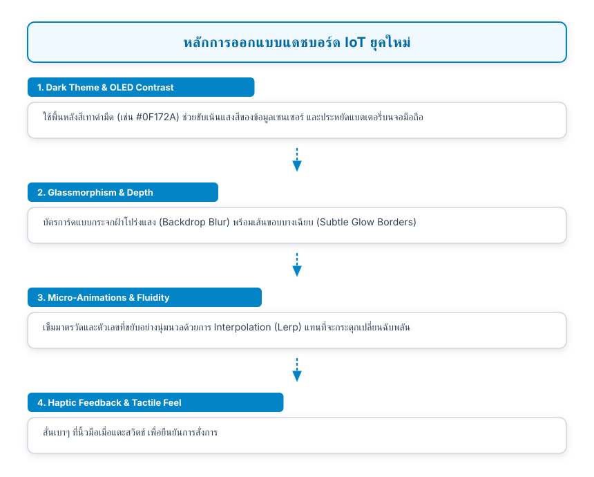

# 12.4 การออกแบบแดชบอร์ด IoT ระดับมืออาชีพ (IoT Dashboard UI Design & Interactive Controls)

---

## 12.4.1 สุนทรียศาสตร์และการออกแบบแดชบอร์ด IoT ยุคใหม่ (Aesthetic Engineering)

แดชบอร์ด IoT ที่ดีต้องเป็นมากกว่าหน้าจอแสดงตัวเลขดิบ ผู้ใช้งานควรสัมผัสได้ถึงความมีชีวิตชีวา ความเสถียร และความแม่นยำของระบบผ่านภาษาการออกแบบเชิงภาพ (Visual Design Language) ซึ่งประกอบด้วย 4 ปัจจัยหลัก

<p align="center"></p>

---

## 12.4.2 การสร้างมาตรวัดเข็มทรงกลมด้วยตนเอง (Custom Radial Gauge via CustomPainter)

ใน Flutter วิธีการสร้างมาตรวัดที่มีประสิทธิภาพสูง กินหน่วยความจำต่ำที่สุด และปรับแต่งได้ 100% โดยไม่ต้องพึ่งพาไลบรารีภายนอกขนาดใหญ่ คือการใช้ **`CustomPainter`** ร่วมกับคณิตศาสตร์ตรีโกณมิติ

<p align="center"></p>

### โค้ดคอมโพเนนต์ Radial Gauge Painter (`radial_gauge_painter.dart`)

```dart
import 'dart:math' as math;
import 'package:flutter/material.dart';

class RadialGaugePainter extends CustomPainter {
  final double value;       // ค่าปัจจุบัน (เช่น 0.0 ถึง 3.3V)
  final double minValue;    // ค่าน้อยสุด (0.0)
  final double maxValue;    // ค่าสูงสุด (3.3)

  RadialGaugePainter({
    required this.value,
    this.minValue = 0.0,
    this.maxValue = 3.3,
  });

  @override
  void paint(Canvas canvas, Size size) {
    final center = Offset(size.width / 2, size.height / 2);
    final radius = math.min(size.width, size.height) / 2 - 16;

    // มุมเริ่มต้น (135 องศา) และมุมกวาดทั้งหมด (270 องศา)
    const startAngle = 135 * (math.pi / 180);
    const sweepAngle = 270 * (math.pi / 180);

    // 1. วาดเส้นขอบวงกลมพื้นหลัง (Track Arc)
    final trackPaint = Paint()
      ..color = const Color(0xFF1E293B)
      ..style = PaintingStyle.stroke
      ..strokeWidth = 14
      ..strokeCap = StrokeCap.round;

    canvas.drawArc(
      Rect.fromCircle(center: center, radius: radius),
      startAngle,
      sweepAngle,
      false,
      trackPaint,
    );

    // 2. คำนวณสัดส่วนค่า (0.0 ถึง 1.0) และวาดแถบสีคืบหน้า (Active Progress Arc)
    final clampedValue = value.clamp(minValue, maxValue);
    final progressRatio = (clampedValue - minValue) / (maxValue - minValue);
    final currentSweep = sweepAngle * progressRatio;

    final progressPaint = Paint()
      ..shader = const SweepGradient(
        colors: [Color(0xFF00E5FF), Color(0xFF00E676), Color(0xFFFF5252)],
        startAngle: 0.0,
        endAngle: math.pi * 2,
      ).createShader(Rect.fromCircle(center: center, radius: radius))
      ..style = PaintingStyle.stroke
      ..strokeWidth = 14
      ..strokeCap = StrokeCap.round;

    canvas.drawArc(
      Rect.fromCircle(center: center, radius: radius),
      startAngle,
      currentSweep,
      false,
      progressPaint,
    );

    // 3. วาดเข็มชี้มาตรวัด (Needle)
    final needleAngle = startAngle + currentSweep;
    final needleLength = radius - 20;
    final needleEnd = Offset(
      center.dx + needleLength * math.cos(needleAngle),
      center.dy + needleLength * math.sin(needleAngle),
    );

    final needlePaint = Paint()
      ..color = Colors.white
      ..strokeWidth = 3
      ..strokeCap = StrokeCap.round;

    canvas.drawLine(center, needleEnd, needlePaint);

    // 4. วาดหมุดศูนย์กลาง (Center Pivot)
    final pivotPaint = Paint()..color = const Color(0xFF00E5FF);
    canvas.drawCircle(center, 7, pivotPaint);
  }

  @override
  bool shouldRepaint(covariant RadialGaugePainter oldDelegate) {
    return oldDelegate.value != value;
  }
}
```

---

## 12.4.3 การสร้างกราฟแนวโน้มแบบเรียลไทม์ (Live Sparkline Trend Chart)

ข้อมูลเซนเซอร์ในอดีต (เช่น 20 จุดล่าสุด) สามารถนำมาวาดเป็นกราฟเส้นขนาดกะทัดรัด (Sparkline) เพื่อให้ผู้ใช้มองเห็นความเปลี่ยนแปลงของแนวโน้มได้อย่างชัดเจน

```dart
class LiveSparklinePainter extends CustomPainter {
  final List<double> history;
  final double maxLimit;

  LiveSparklinePainter({required this.history, this.maxLimit = 3.3});

  @override
  void paint(Canvas canvas, Size size) {
    if (history.length < 2) return;

    final paint = Paint()
      ..color = const Color(0xFF00E5FF)
      ..strokeWidth = 2.5
      ..style = PaintingStyle.stroke
      ..strokeCap = StrokeCap.round;

    final path = Path();
    final dxStep = size.width / (history.length - 1);

    for (int i = 0; i < history.length; i++) {
      final x = i * dxStep;
      final normalizedY = (history[i] / maxLimit).clamp(0.0, 1.0);
      final y = size.height - (normalizedY * size.height);

      if (i == 0) {
        path.moveTo(x, y);
      } else {
        path.lineTo(x, y);
      }
    }

    canvas.drawPath(path, paint);
  }

  @override
  bool shouldRepaint(covariant LiveSparklinePainter oldDelegate) => true;
}
```

---

## 12.4.4 การออกแบบการ์ดสวิตช์สั่งการสไตล์ Glassmorphism (Glassmorphism Actuator Card)

การ์ดสำหรับสั่งเปิด-ปิดหลอดไฟ ควรมีตัวบ่งชี้สถานะแสงเรือง (Glow Effect) พร้อมการสัมผัสแบบสั่น (Haptic Feedback)

```dart
import 'package:flutter/material.dart';
import 'package:flutter/services.dart';

class ActuatorCard extends StatelessWidget {
  final bool isOn;
  final ValueChanged<bool> onToggle;

  const ActuatorCard({super.key, required this.isOn, required this.onToggle});

  @override
  Widget build(BuildContext context) {
    return Container(
      padding: const EdgeInsets.all(20),
      decoration: BoxDecoration(
        color: const Color(0xFF1E293B).withOpacity(0.7),
        borderRadius: BorderRadius.circular(24),
        border: Border.all(
          color: isOn ? const Color(0xFF00E676).withOpacity(0.5) : Colors.white10,
          width: 1.5,
        ),
        boxShadow: isOn
            ? [
                BoxShadow(
                  color: const Color(0xFF00E676).withOpacity(0.2),
                  blurRadius: 16,
                  spreadRadius: 2,
                )
              ]
            : [],
      ),
      child: Row(
        mainAxisAlignment: MainAxisAlignment.spaceBetween,
        children: [
          Row(
            children: [
              Icon(
                isOn ? Icons.lightbulb : Icons.lightbulb_outline,
                color: isOn ? const Color(0xFF00E676) : Colors.white38,
                size: 36,
              ),
              const SizedBox(width: 16),
              Column(
                crossAxisAlignment: CrossAxisAlignment.start,
                children: [
                  const Text(
                    'ESP32 Test LED (GPIO 8)',
                    style: TextStyle(fontSize: 16, fontWeight: FontWeight.bold, color: Colors.white),
                  ),
                  Text(
                    isOn ? 'กำลังทำงาน (ONLINE / ON)' : 'ปิดการทำงาน (OFF)',
                    style: TextStyle(
                      fontSize: 13,
                      color: isOn ? const Color(0xFF00E676) : Colors.white38,
                    ),
                  ),
                ],
              ),
            ],
          ),
          Switch(
            value: isOn,
            activeColor: const Color(0xFF00E676),
            onChanged: (val) {
              HapticFeedback.lightImpact(); // สั่นตอบสนองเบาๆ ทันทีที่แตะ
              onToggle(val);
            },
          ),
        ],
      ),
    );
  }
}
```

---

## 12.4.5 ป้ายสถานะการเชื่อมต่อ (Dynamic Connection Status Banner)

เพื่อสร้างความมั่นใจแก่ผู้ใช้ว่าแอปพลิเคชันยังคงเชื่อมต่ออยู่กับ Broker และบอร์ดฮาร์ดแวร์ เราจะสร้างวิดเจ็ตแสดงผลสถานะที่มีจุดไฟกะพริบ (Pulsing Dot)

```dart
Widget buildConnectionStatusHeader(bool isBrokerConnected, bool isDeviceOnline) {
  final isHealthy = isBrokerConnected && isDeviceOnline;
  return Container(
    padding: const EdgeInsets.symmetric(horizontal: 16, vertical: 8),
    decoration: BoxDecoration(
      color: isHealthy ? const Color(0x2200E676) : const Color(0x22FF5252),
      borderRadius: BorderRadius.circular(12),
      border: Border.all(
        color: isHealthy ? const Color(0xFF00E676) : const Color(0xFFFF5252),
      ),
    ),
    child: Row(
      mainAxisSize: MainAxisSize.min,
      children: [
        Icon(
          Icons.circle,
          size: 10,
          color: isHealthy ? const Color(0xFF00E676) : const Color(0xFFFF5252),
        ),
        const SizedBox(width: 8),
        Text(
          !isBrokerConnected
              ? 'Broker ขาดการเชื่อมต่อ'
              : !isDeviceOnline
                  ? 'ESP32 ออฟไลน์ (Waiting LWT)'
                  : 'ระบบออนไลน์สมบูรณ์ (Synced)',
          style: TextStyle(
            fontSize: 12,
            fontWeight: FontWeight.bold,
            color: isHealthy ? const Color(0xFF00E676) : const Color(0xFFFF5252),
          ),
        ),
      ],
    ),
  );
}
```
