# ใบงานการทดลองที่ 12.4
### การทดสอบผสานรวมระบบครบวงจร (ESP32-C3 Hardware <-> Mosquitto Broker <-> Flutter Mobile App)

> [!NOTE] **คำชี้แจง**
> ในใบงานนี้นักศึกษาจะได้นำทุกจิ๊กซอว์ที่พัฒนามาตั้งแต่สัปดาห์ที่ 11 และสัปดาห์ที่ 12 มาร้อยเรียงทำงานร่วมกันเป็น **ระบบนิเวศ IoT แบบครบวงจร (Complete End-to-End IoT Ecosystem)** โดยบอร์ดฮาร์ดแวร์จริง ESP32-C3 จะสื่อสารกับแอปพลิเคชัน Flutter บนสมาร์ตโฟนผ่าน Mosquitto Broker เพื่อทดสอบการหมุนปรับค่า Potentiometer ทางกายภาพแล้วเห็นเข็มหน้าจอมือถือขยับทันที และการแตะสวิตช์บนมือถือแล้วหลอดไฟ LED จริงบนโต๊ะทดลองสว่างขึ้นในเสี้ยววินาที

---

## 1. วัตถุประสงค์การทดลอง
1. สามารถผสานรวมหน้าจอควบคุม Actuator และหน้าจอแสดงผล Telemetry เข้าเป็นแอปพลิเคชันรวมศูนย์ (Unified Multi-tab IoT App) ได้
2. สามารถเชื่อมต่อฮาร์ดแวร์บอร์ด ESP32-C3 เข้ากับ Mosquitto Broker และสื่อสารกับแอป Flutter ได้สำเร็จ
3. สามารถวัดและวิเคราะห์ความหน่วงเวลาตอบสนองแบบไป-กลับ (Round-Trip Time - RTT) ของคำสั่งควบคุมได้
4. สามารถทดสอบความทนทานต่อสภาวะเครือข่ายล้มเหลว (Fault-Tolerance & LWT Handling) ในสถานการณ์จริงได้

---

## 2. แผนผังการทดสอบระบบแบบครบวงจร (End-to-End Verification Pipeline)

<p align="center"></p>

---

## 3. ขั้นตอนการทดลอง (Step-by-Step Activities)

### กิจกรรมที่ 12-4.1: โค้ดรวมศูนย์แอปพลิเคชัน Flutter (`lib/main.dart`)

นำหน้าจอควบคุมและหน้าจอแสดงผลมาประกอบกันด้วย `BottomNavigationBar` เพื่อให้เป็นแอปพลิเคชัน Smart IoT ที่สมบูรณ์แบบ:

```dart
import 'package:flutter/material.dart';
import 'actuator_control_screen.dart';
import 'telemetry_dashboard_screen.dart';

void main() {
  runApp(const UnifiedIotApp());
}

class UnifiedIotApp extends StatelessWidget {
  const UnifiedIotApp({super.key});

  @override
  Widget build(BuildContext context) {
    return MaterialApp(
      title: 'ESP32 Smart IoT Commander',
      theme: ThemeData.dark().copyWith(
        scaffoldBackgroundColor: const Color(0xFF0F172A),
        colorScheme: const ColorScheme.dark(
          primary: Color(0xFF00E5FF),
          secondary: Color(0xFF00E676),
        ),
      ),
      home: const MainNavigationShell(),
      debugShowCheckedModeBanner: false,
    );
  }
}

class MainNavigationShell extends StatefulWidget {
  const MainNavigationShell({super.key});

  @override
  State<MainNavigationShell> createState() => _MainNavigationShellState();
}

class _MainNavigationShellState extends State<MainNavigationShell> {
  int _currentIndex = 0;
  // หมายเลข IP ของเครื่องรัน Broker
  final String brokerIp = '192.168.1.100'; 

  late final List<Widget> _pages;

  @override
  void initState() {
    super.initState();
    _pages = [
      TelemetryDashboardScreen(brokerIp: brokerIp),
      ActuatorControlScreen(brokerIp: brokerIp),
    ];
  }

  @override
  Widget build(BuildContext context) {
    return Scaffold(
      body: _pages[_currentIndex],
      bottomNavigationBar: NavigationBar(
        selectedIndex: _currentIndex,
        onDestinationSelected: (idx) => setState(() => _currentIndex = idx),
        backgroundColor: const Color(0xFF1E293B),
        indicatorColor: const Color(0xFF00E5FF).withOpacity(0.2),
        destinations: const [
          NavigationDestination(
            icon: Icon(Icons.speed),
            selectedIcon: Icon(Icons.speed, color: Color(0xFF00E5FF)),
            label: 'Telemetry Gauge',
          ),
          NavigationDestination(
            icon: Icon(Icons.toggle_on_outlined),
            selectedIcon: Icon(Icons.toggle_on, color: Color(0xFF00E676)),
            label: 'Actuator Switch',
          ),
        ],
      ),
    );
  }
}
```

---

### กิจกรรมที่ 12-4.2: การเตรียมและสตาร์ตเฟิร์มแวร์ ESP32-C3

1. ใช้โปรเจกต์ `Lab11-2_MQTT_Client` จากสัปดาห์ที่ 11
2. ตรวจสอบว่าในไฟล์ `main/main.c` ของ ESP-IDF:
   * ตั้งค่า Broker IP ชี้ไปยังเครื่องคอมพิวเตอร์ของคุณ
   * มีการ Publish ค่า Potentiometer (GPIO 0) ไปยัง `iot/esp32/telemetry` ทุก 500 ms
   * มีการ Subscribe หัวข้อ `iot/esp32/control` และสั่งควบคุม LED บนขา GPIO 8
   * มีการส่งข้อความยืนยันไปยัง `iot/esp32/led_ack` เมื่อเปลี่ยนสถานะหลอดไฟสำเร็จ
   * มีการตั้งค่า LWT ไปยัง `iot/esp32/status` ด้วยข้อความ `"offline"`
3. สั่งคอมไพล์และแฟลชลงบอร์ด ESP32-C3:
```powershell
idf.py flash monitor
```

---

### กิจกรรมที่ 12-4.3: การทดสอบ 4 กรณีทดสอบวิกฤต (Verification Test Matrix)

ให้นักศึกษาทำการทดสอบและบันทึกผลการทดลองลงในตาราง:

| รายการทดสอบ | การกระทำเชิงกายภาพ | พฤติกรรมที่คาดหวัง | ผลการทดลองจริง (ผ่าน/ไม่ผ่าน) |
| :--- | :--- | :--- | :--- |
| **Test Case 1: Telemetry Monitoring** | ใช้ไขควงหมุน Potentiometer จากซ้ายสุดไปขวาสุด | เข็มบน Radial Gauge หมุนจาก 0.0V ไปหา 3.3V อย่างนุ่มนวล และกราฟประวัติขยับเป็นเส้นโค้ง | |
| **Test Case 2: Actuator Remote Control** | แตะสวิตช์บนแอปเพื่อเปิดไฟ LED | หลอดไฟ LED สีเขียว/แดงบนเบรดบอร์ดติดสว่างทันที และแอปได้รับการตอบรับกลับมาอย่างถูกต้อง | |
| **Test Case 3: Unsolicited Physical Change** | ต่อสายสลับขา LED ให้ดับโดยตรง | แอปพลิเคชันได้รับค่า ACK ใหม่และอัปเดตสวิตช์ตามความเป็นจริง | |
| **Test Case 4: Fault Tolerance (LWT)** | ถอดสาย USB จ่ายไฟของบอร์ด ESP32 ออกกะทันหัน | ภายใน 20–30 วินาที ป้ายสถานะบนแอปต้องเปลี่ยนเป็น "OFFLINE" สีแดง และไม่ยอมให้กดสั่งการ | |

---

### กิจกรรมที่ 12-4.4: การวัดความหน่วงเวลาในการควบคุม (Control Latency Benchmark)

1. วัดเวลาตั้งแต่แตะสวิตช์ในแอป จนกระทั่งได้รับข้อความยืนยัน `iot/esp32/led_ack` กลับมา
2. บันทึกผลเปรียบเทียบระหว่างการเชื่อมต่อผ่าน Wi-Fi ในบ้าน กับการเชื่อมต่อสมาร์ตโฟนผ่านเครือข่ายมือถือ 4G/5G (โดยชี้ไปที่ Public MQTT Broker หรือ Cloud Broker)

---

## 4. คำถามและข้อคิดเห็นท้ายบทเรียน
1. เมื่อเปรียบเทียบการพัฒนาด้วย Flutter ในสัปดาห์นี้ กับการเปิดหน้าเว็บ HTTP บนเบราว์เซอร์ในสัปดาห์ที่ 8-10 ข้อใดให้ประสบการณ์การใช้งาน (UX) และความเสถียรที่ดีกว่าเมื่อข้อมูลเซนเซอร์มาด้วยความถี่สูง? เพราะเหตุใด?
2. หากต้องการนำแอปพลิเคชันนี้ไปเผยแพร่จริงบน Google Play Store หรือ Apple App Store ขั้นตอนความปลอดภัยที่ต้องปรับปรุงเพิ่มเติมมีอะไรบ้าง? (พิจารณาเรื่อง TLS 8883, การเข้ารหัส Token ยืนยันตัวตน, และการเก็บรหัสผ่าน)
